# Deploying the Detection Model

The Grove Vision AI V2 runs the object detection model used by the tracker. This guide explains how to deploy a model to the module with SenseCraft AI, Seeed Studio's web-based platform for compatible edge-AI devices. No firmware needs to be built or flashed manually.

Two workflows are available: the main SenseCraft AI model library, and the SenseCraft AI Model Assistant. Use either one.

## Before You Start

- Connect the Grove Vision AI V2 to your computer with a USB cable.
- Use a browser that supports Web Serial (for example Chrome or Edge). Both workflows ask the browser to select the module's serial port.

## Option 1: SenseCraft AI (Model Library)

Select a model from the SenseCraft AI library and deploy it to the module.

1. Open [SenseCraft AI](https://sensecraft.seeed.cc/ai/model/).

2. Select the required model.

   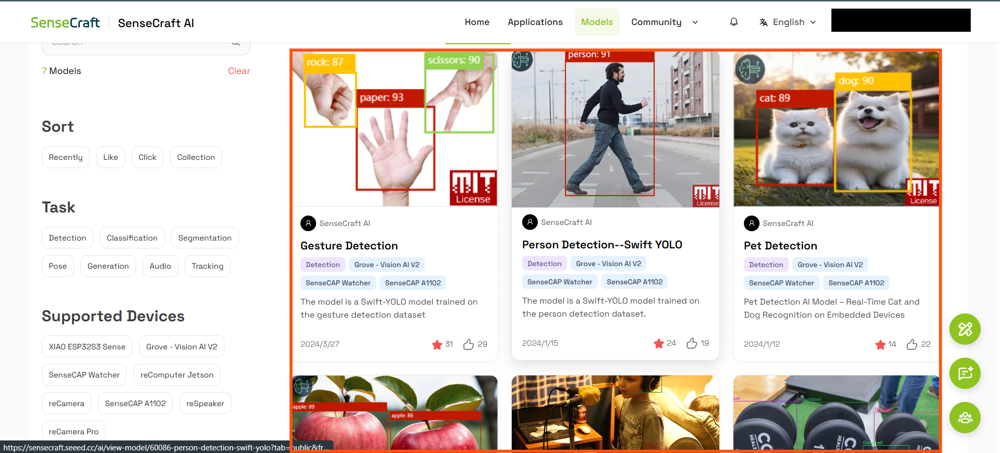

3. Click **Deploy Model**.

   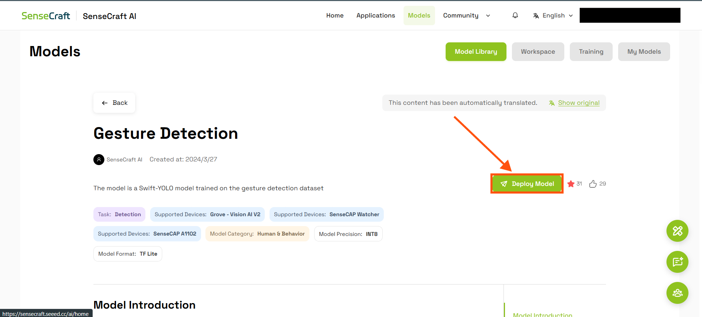

4. Scroll down and click **Connect Device**.

   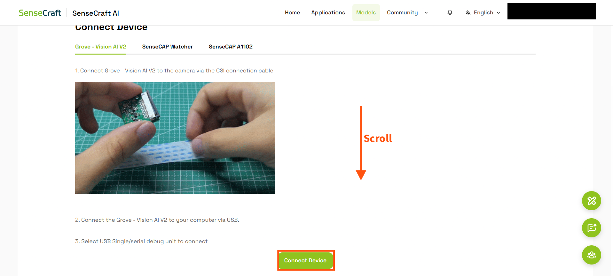

5. In the dialog, click **Confirm**.

   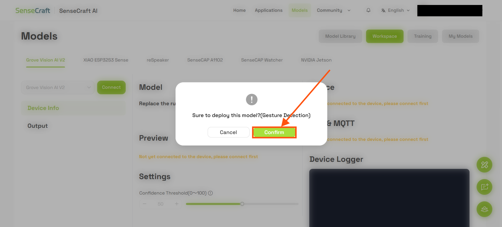

6. In the browser's serial-port prompt, select the port connected to the Grove Vision AI V2 and click **Connect**.

   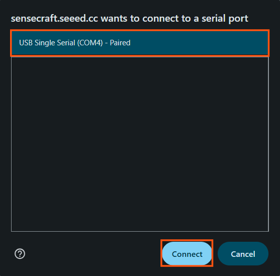

7. Wait until the model has been deployed and flashed to the module.

8. Test the result with the camera **Preview**. The **Device Logger** shows inference information from the module.

   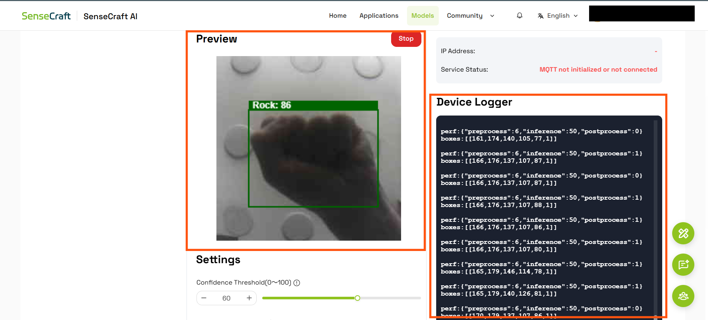

9. For detection models, adjust the **Confidence** and **IoU** thresholds with their sliders.

   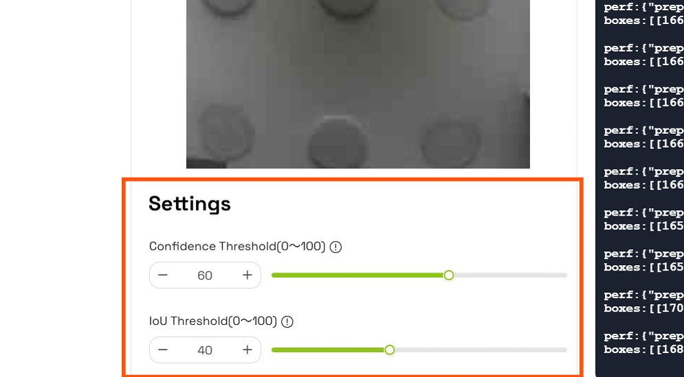

## Option 2: SenseCraft AI Model Assistant

The SenseCraft AI Model Assistant is another web-based workflow for connecting to the module and deploying a selected model.

1. Open the [SenseCraft AI Model Assistant](https://seeed-studio.github.io/SenseCraft-Web-Toolkit/#/setup/process).

2. In the upper-right corner, open the device menu, choose **Grove Vision AI (V2)** and click **Connect**.

   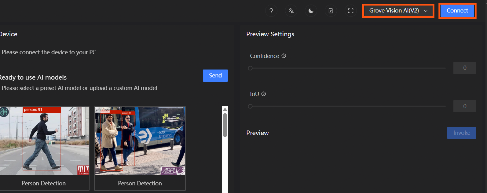

3. In the browser's serial-port prompt, select the port connected to the Grove Vision AI V2 and click **Connect**.

   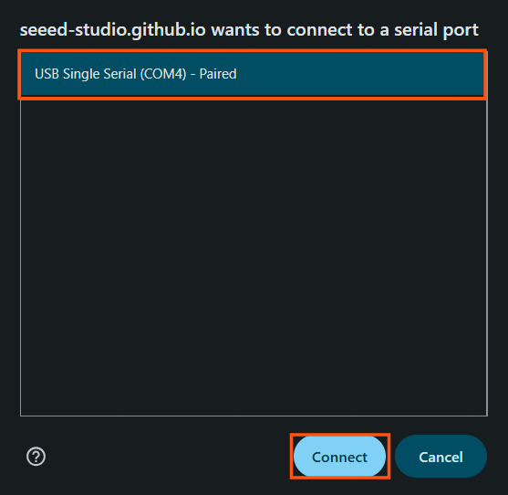

4. Select the required model and click **Send**.

   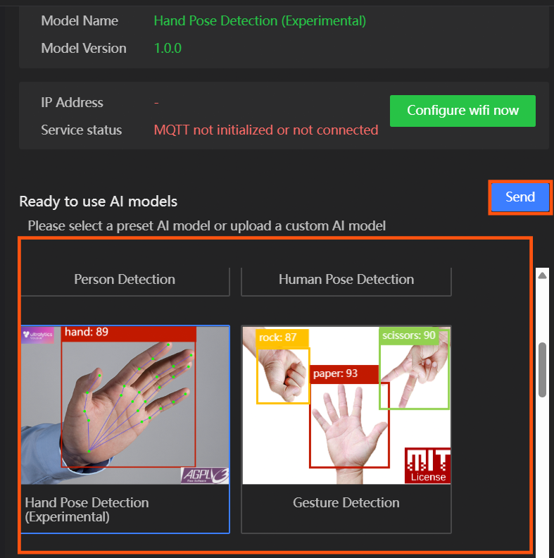

5. Wait until the model has been deployed and flashed to the module.

6. Test the inference results with the camera **Preview**.

   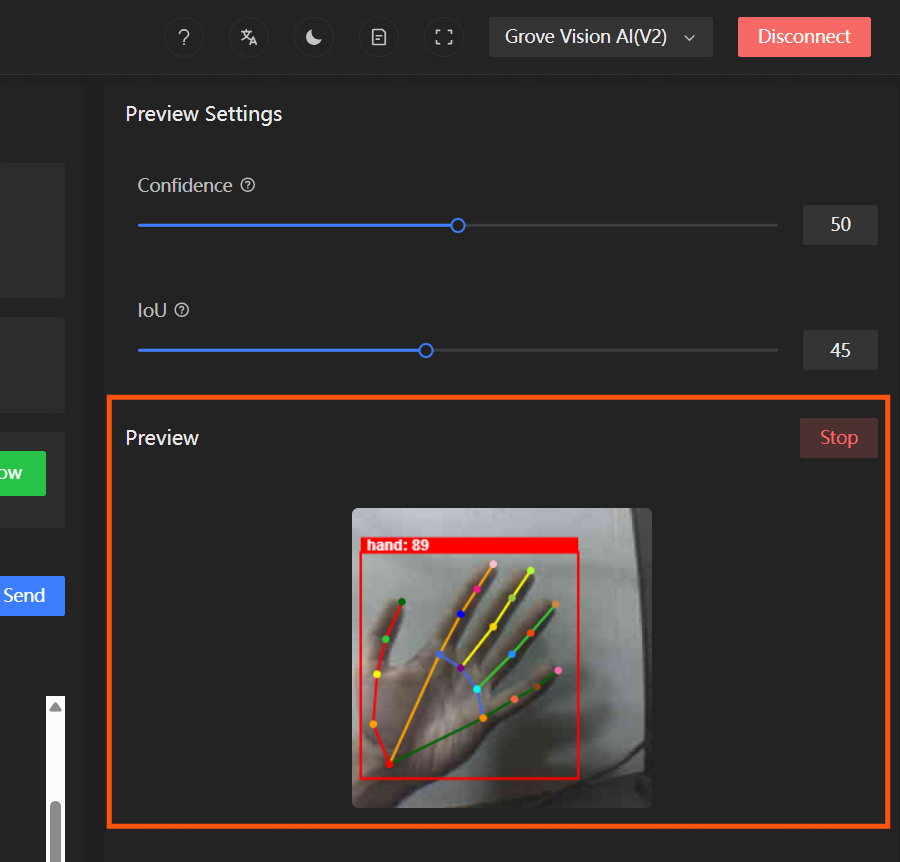

7. Turn the **Device Logger** on or off with the document-shaped logger button.

   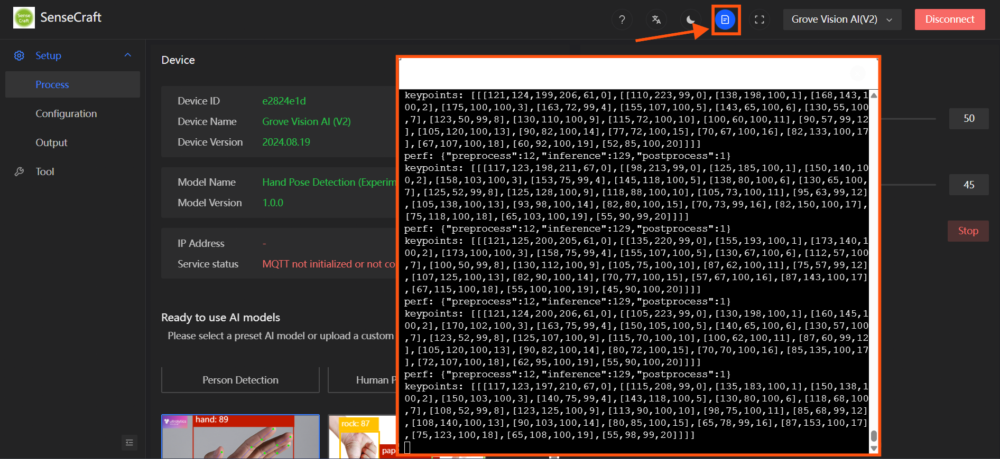

8. For detection models, adjust the **Confidence** and **IoU** thresholds with their sliders.

   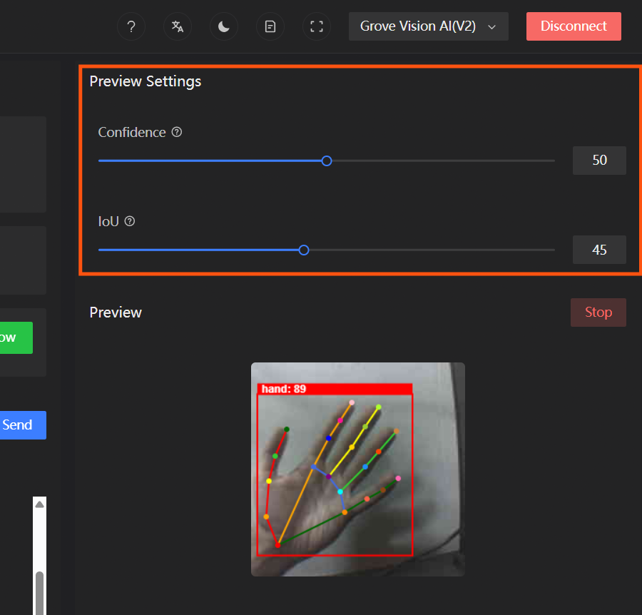

## References

- [SenseCraft AI](https://sensecraft.seeed.cc/ai/model/)
- [SenseCraft AI Model Assistant](https://seeed-studio.github.io/SenseCraft-Web-Toolkit/#/setup/process)
- [Grove Vision AI V2 — Software Support](https://wiki.seeedstudio.com/grove_vision_ai_v2_software_support/)
- [Grove Vision AI V2a](https://wiki.seeedstudio.com/grove_vision_ai_v2a/)